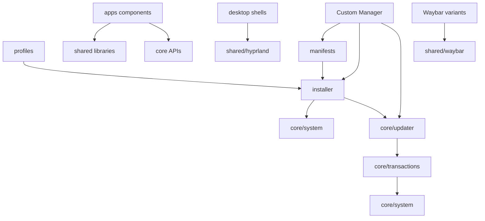

# Dependency graph

This graph is a high-level dependency model. Detailed file-level references remain to be verified during each migration group.

## Critical contracts

- `manifests/components.tsv` names historical installer entry points. Those commands must remain callable during the transition.
- `manifests/update-files.json` maps repository source globs to installed destinations. Moving a source directory without updating this manifest breaks updates even if a fresh install appears to work.
- `core/update/main.py` imports sibling updater modules and handles Git history, snapshots, transactions and rollback. Keep its package/import contract stable or migrate the complete updater package atomically.
- `install-v3.sh` owns the current PeriphX source layout and must be updated together with all PeriphX source paths.
- `install-nova2.sh` selects three Waybar variants and installs Hyprland snippets; these are coupled groups, not independent folders.
- Custom Manager has its own C path resolver and expects repository markers; preserve that contract or extend it with tests before relocating it.
